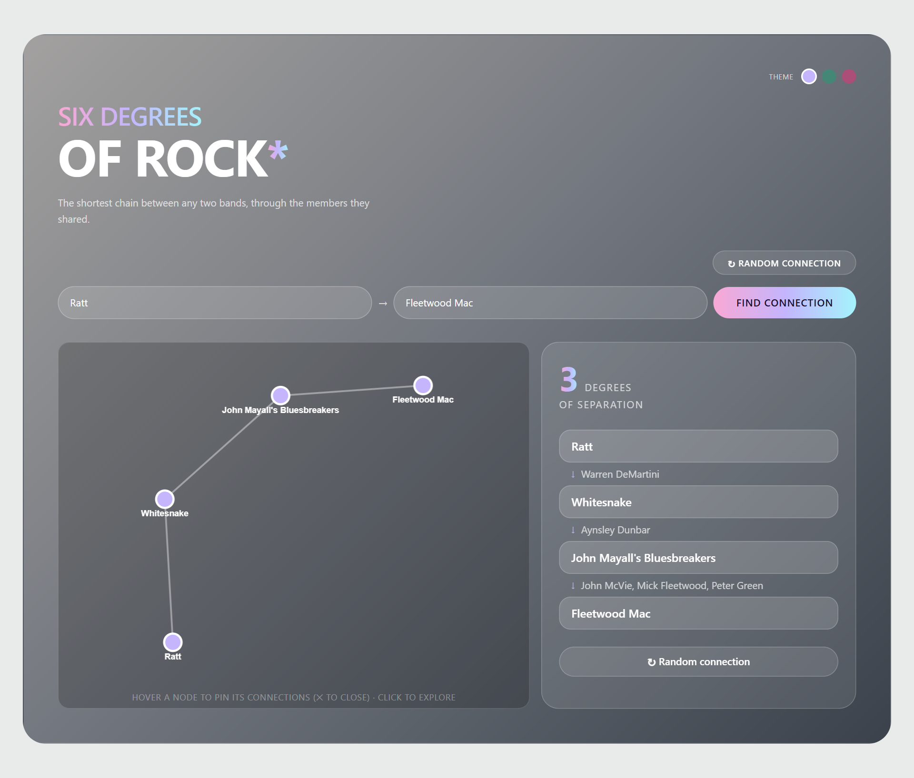
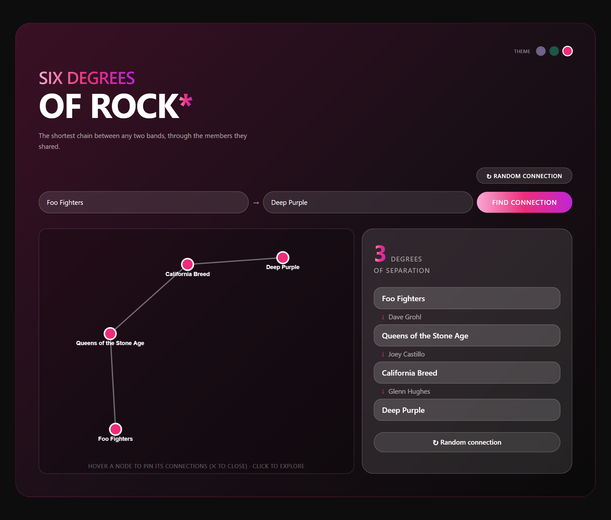
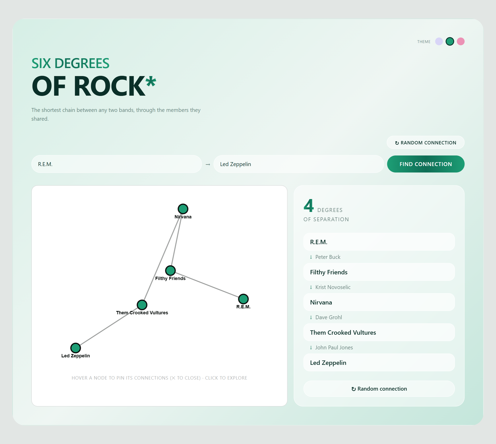
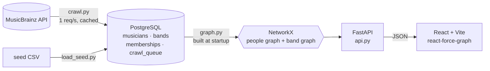

<div align="center">


# Six Degrees of Rock

**The Kevin Bacon game for rock music.** Pick any two bands or musicians and find the shortest chain of shared members between them.

[](https://github.com/alan-connor/six-degrees/actions/workflows/ci.yml)
[](LICENSE)
[](https://claude.com/claude-code)
<br />


### [▶ Try the live demo](https://alan-connor.github.io/six-degrees-demo/)

<sub>The ten longest chains in the network, as a static site. No install needed. Source: <a href="https://github.com/alan-connor/six-degrees-demo">six-degrees-demo</a></sub>



</div>

---

## What is Six Degrees of Rock?

Six Degrees of Rock is a full-stack data project that crawls [MusicBrainz](https://musicbrainz.org), stores who-played-in-which-band in PostgreSQL, builds a graph in memory, and serves shortest paths through an API to an interactive web UI.

```
Kurt Cobain ──Nirvana──▶ Dave Grohl ──Them Crooked Vultures──▶ John Paul Jones ──Led Zeppelin──▶ Jimmy Page
                                        3 degrees of separation
```

It covers every stage of a real data product: **gather → store → model → analyze → serve → visualize.**

It was designed and built **with [Claude Code](https://claude.com/claude-code) as a pair programmer**, from the first schema to the final UI. The repo includes the plan, the decision log and a reproducible build spec alongside the code. See [Built with Claude](#built-with-claude).

## Highlights

| | |
|---|---|
| 🕸️ **Two graph views** | The API serves a *people view* (musicians linked by a shared band) and a *band view* (bands linked by a shared member), both built from the same membership data. The UI explores the band view. |
| 🔎 **Shortest paths on demand** | Breadth-first search over ~5,400 musicians and ~60,000 edges answers in milliseconds. |
| 🧬 **Homonym-safe identity** | Every entity is keyed on its MusicBrainz ID, not its name. Mick Jones (The Clash) ≠ Mick Jones (Foreigner), and the two Skid Rows stay separate. |
| 🕷️ **A polite, resumable crawler** | Snowball crawl of MusicBrainz with a persistent queue, 1 req/sec rate limiting, an on-disk cache, a rock-genre boundary and per-record error handling. |
| 🎨 **Interactive graph UI** | Force-directed graph with hover-to-pin, click-to-explore, a random-connection button and three themes. |
| 📐 **Documented decisions** | Every modeling choice (edge rule, scope, genre boundary, identity) is written down with the reasoning and the alternatives that were rejected. |

## Screenshots

<table>
  <tr>
    <td></td>
    <td></td>
  </tr>
  <tr>
    <td align="center"><sub><b>Dark</b>: Foo Fighters → Deep Purple via Queens of the Stone Age and California Breed</sub></td>
    <td align="center"><sub><b>Light</b>: R.E.M. → Led Zeppelin via Nirvana and Them Crooked Vultures</sub></td>
  </tr>
</table>

## By the numbers

Snapshot of the crawled dataset:

| Metric | Value |
|---|---:|
| Musicians stored | ~6,060 |
| Bands stored | ~2,590 |
| Memberships | ~10,790 |
| Musicians in the rock graph | 5,452 |
| Musician-to-musician edges | ~60,000 |
| Bands in the band graph | 888 |
| Connected components | **1** |
| Genres in the rock allowlist | 113 |

## How it works



1. **Gather.** `crawl.py` starts from a set of seed bands and crawls outward through MusicBrainz "member of band" relations: a band, its members, their other bands, and so on. The queue lives in Postgres, so a crawl can stop and resume at any point.
2. **Store.** Three domain tables (`musicians`, `bands`, `memberships`) are keyed on the MusicBrainz ID. A partial unique index keeps hand-seeded rows deduplicated by name and still allows genuine homonyms.
3. **Model.** `graph.py` projects the bipartite musician–band data onto either axis and keeps only bands that aren't confirmed non-rock.
4. **Analyze.** Shortest path = breadth-first search = degrees of separation. `ids_for_name()` resolves a name to every matching entity, so an ambiguous name is never guessed silently.
5. **Serve and visualize.** FastAPI exposes six JSON endpoints, three per view. The React app draws band-to-band paths as a force-directed graph you can explore.

### Design decisions worth reading

These are written up in full in [docs/PROJECT_STATE.md](docs/PROJECT_STATE.md):

- **Edges ignore dates.** Two musicians are linked if they were *ever* in the same band, the same "same movie, not same scene" rule the Kevin Bacon game uses. Requiring overlapping tenures would drop real edges and make stint modeling load-bearing.
- **Membership only, not session credits.** An artist can have ~50× more recording credits than band memberships. Adding credits explodes the crawl and turns compilations and session players into false mega-hubs.
- **Identity is the MBID, never the name.** An early version merged homonyms into one node and invented false links. The fix and the migration that split 15 merged entities are documented.
- **Connectivity was measured, not assumed.** The graph is one connected component. Removing the 120-member collective Pigface leaves the core connected at the same hop counts.

## Getting started

### Prerequisites

- Python 3.11+
- Node.js 20+
- Docker (for PostgreSQL)

### 1. Start PostgreSQL

```bash
docker compose up -d
```

This runs Postgres on `localhost:5432` with the defaults that `backend/db.py` expects. Override them with `PGHOST`, `PGPORT`, `PGUSER`, `PGPASSWORD` and `PGDATABASE` (see [.env.example](.env.example)).

### 2. Set up the backend and load the seed data

```bash
python -m venv .venv
source .venv/bin/activate          # Windows: .venv\Scripts\activate
pip install -r requirements.txt

cd backend
python setup/create_tables.py      # create the schema
python setup/load_seed.py          # 170 hand-curated memberships, 46 bands
python graph.py                    # sanity check: Kurt Cobain -> Jimmy Page
```

The seed is a small, fully connected network of classic rock, prog, metal and grunge, enough to explore right away.

### 3. (Optional) Grow the network from MusicBrainz

```bash
python crawl.py --seed             # resolve seed bands to MusicBrainz IDs
python crawl.py --limit 500        # crawl up to 500 entities (resumable)
python crawl.py --add-seeds        # add more scenes from data/extra_seed_bands.txt
```

The crawler respects MusicBrainz's 1 request/second limit and caches every response under `data/cache/`, so re-runs are free. A full depth-2 crawl takes a few hours.

### 4. Run the API and the UI

```bash
# terminal 1 (from backend/)
uvicorn api:app --reload           # http://127.0.0.1:8000/docs

# terminal 2
cd frontend
npm install
npm run dev                        # http://localhost:5173
```

> **VS Code:** press <kbd>Ctrl</kbd>+<kbd>Shift</kbd>+<kbd>B</kbd> to run the **Start all** task (Postgres, API and UI together), or <kbd>F5</kbd> to debug the API with breakpoints.

## API

Interactive docs are served at `/docs` (Swagger UI).

| Endpoint | Description |
|---|---|
| `GET /musicians` | All musicians in the graph: `[{id, name, degree, hint?}]` |
| `GET /path?from=&to=` | Shortest chain between two musicians (ids or names) |
| `GET /neighbors?id=` | A musician's bandmates, for graph exploration |
| `GET /bands` | All bands in the band graph |
| `GET /band-path?from=&to=` | Shortest chain between two bands |
| `GET /band-neighbors?id=` | Bands that shared a member with this one |

```bash
curl "http://127.0.0.1:8000/path?from=Kurt%20Cobain&to=Jimmy%20Page"
```

```json
{
  "connected": true,
  "degrees": 3,
  "chain": [
    { "id": 59, "name": "Kurt Cobain",     "band_to_next": "Nirvana" },
    { "id": 55, "name": "Dave Grohl",      "band_to_next": "Them Crooked Vultures" },
    { "id": 74, "name": "John Paul Jones", "band_to_next": "Led Zeppelin" },
    { "id": 88, "name": "Jimmy Page",      "band_to_next": null }
  ]
}
```

When a name matches more than one entity (for example `Mick Jones`), the API returns an `{"ambiguous": ...}` payload listing the candidates with a distinguishing hint instead of guessing.

## Project structure

```
six-degrees/
├── backend/
│   ├── api.py            # FastAPI app: six endpoints over two graph projections
│   ├── graph.py          # Postgres -> NetworkX, homonym-aware shortest paths
│   ├── crawl.py          # MusicBrainz snowball crawler
│   ├── rock_genres.py    # 113-genre allowlist that defines the crawl boundary
│   ├── db.py             # shared connection (env-var configured)
│   └── setup/            # schema, seed loader, connection check, BFS walkthrough
├── frontend/             # Vite + React 19 + Tailwind CSS v4 + react-force-graph-2d
├── data/                 # seed CSV + extra seed bands (crawl cache is gitignored)
└── docs/
    ├── ROADMAP.md        # the phased plan the project followed
    ├── PROJECT_STATE.md  # living decision log and current state
    └── BUILD_PROMPT.md   # one-file spec to rebuild the project with an AI agent
```

## Built with Claude

This project is a showcase of **building a real, multi-layer system with an AI coding agent**. Claude Code worked as a pair programmer at every phase. The human set direction, made the calls and checked the results against real data.

What that looked like in practice:

- **Plan first.** The project followed a phased roadmap ([docs/ROADMAP.md](docs/ROADMAP.md)): setup, schema, graph on seed data, crawler, identity fix, API, UI. Each phase was runnable before moving on.
- **Decisions are recorded with their reasoning.** [docs/PROJECT_STATE.md](docs/PROJECT_STATE.md) was kept up to date throughout as a handoff note, so any session (human or AI) could pick up with full context.
- **Bugs were found against real data.** Scaling the crawl exposed real problems that were diagnosed and fixed together:
  - Unicode crashing a Windows console.
  - Foreign keys broken by null MusicBrainz `type` fields.
  - Homonyms silently merged by a `UNIQUE(name)` constraint, then split again with a targeted migration.
- **Claims were measured.** "Is Pigface a false mega-hub?" was answered by deleting it and recomputing, not by guessing.
- **The process is reproducible.** [docs/BUILD_PROMPT.md](docs/BUILD_PROMPT.md) condenses the whole project, including decisions, build order and the traps hit along the way, into a single spec you can hand to a coding agent to rebuild it from scratch.

## Roadmap

- [x] Schema, seed loader and graph on seed data
- [x] MusicBrainz crawler with a genre boundary
- [x] Homonym-safe identity and migration
- [x] FastAPI backend with people and band views
- [x] React UI with an interactive force graph and themes
- [ ] Automated tests and a tighter CORS policy for deployment
- [ ] Hosted deployment
- [ ] Natural-language "how are these two connected?" with a narrated chain
- [ ] Optional Neo4j port

## Data and attribution

Band and membership data comes from [MusicBrainz](https://musicbrainz.org), the open music encyclopedia. MusicBrainz core data is released under [CC0](https://creativecommons.org/publicdomain/zero/1.0/). The crawler identifies itself with a descriptive User-Agent and stays within the [MusicBrainz API rate limits](https://musicbrainz.org/doc/MusicBrainz_API/Rate_Limiting). The crawled database is not committed to this repo; the setup scripts and crawler rebuild it.

## License

Licensed under the [MIT License](LICENSE).
